# Bewerberaufgabe System Engineer – Elastic Stack (Homelab)


## Inhalt

1. [Cluster mit drei Nodes und Frozen Tier](#1-cluster-mit-drei-nodes-und-frozen-tier)
2. [Snapshots und Lifecycle bis Frozen](#2-snapshots-und-lifecycle-bis-frozen)
3. [Fleet Server und Elastic Agent](#3-fleet-server-und-elastic-agent)
4. [Fleet Policy ausrollen](#4-fleet-policy-ausrollen)
5. [Konfiguration verstehen und abfragen](#5-konfiguration-verstehen-und-abfragen)

---

## Versionen

| Komponente | Version |
|---|---|
| Elastic Stack (Elasticsearch, Kibana, Elastic Agent / Fleet Server) | **9.5.5** (in `.env` als `STACK_VERSION` gepinnt) |
| Lizenz | 30-Tage-Trial (für Searchable Snapshots / Frozen Tier), Nachweis: [`01-license.json`](docs/evidence/01-license.json) |
| Betriebssystem | Ubuntu 26.04.1 LTS |
| Docker / Compose | 29.9.1 / v5.6.0 |

## Voraussetzungen

**Hardware:** 6 Cores, 16 GB RAM (davon ca. 10.5 GB fest an die Container vergeben), ca. 475 GB Disk mit LVM.

**Host:**
- Docker Engine und Compose-Plugin installiert. Docker wird nur über `sudo` benutzt, der User ist nicht in der `docker`-Gruppe.
- Swap deaktiviert.
- `vm.max_map_count` ≥ 1048576. Unter Ubuntu 26.04 ist das bereits Default.
- Zeitsynchronisation aktiv (Chrony).
- LVs bzw. Verzeichnisse, die für GID 0 schreibbar sind:

```bash
sudo mkdir -p /srv/snapshots/es-repo /srv/es-frozen
sudo chgrp 0 /srv/snapshots/es-repo /srv/es-frozen
sudo chmod 770 /srv/snapshots/es-repo /srv/es-frozen
```

Das Disk-Layout ist unter [Architekturentscheide](docs/decisions.md#host) beschrieben.

## Startanleitung

**1. Repository und Secrets**

```bash
git clone git@github.com:gugudegugu/bewerberaufgabe.git elastic-homelab
cd elastic-homelab
cp .env.example .env
chmod 600 .env
vim .env    # ELASTIC_PASSWORD, KIBANA_PASSWORD, KIBANA_ENCRYPTION_KEY (z. B. openssl rand -hex 32) setzen
```

**2. Erster Start des Clusters**

Beim **allerersten** Start (leere Datenverzeichnisse) braucht Elasticsearch `cluster.initial_master_nodes`, damit sich der Cluster bilden kann. Die Zeile ist nach dem ersten Start wieder entfernt worden (siehe [Decisions](docs/decisions.md#cluster)). Für einen Neuaufbau trägt man sie bei es01–es03 unter `environment:` vorübergehend wieder ein:

```yaml
      - cluster.initial_master_nodes=es01,es02,es03
```

```bash
sudo docker compose up -d setup es01 es02 es03 kibana
sudo docker compose ps
```

Nach dem ersten Start mit Status green die Zeile wieder entfernen.

**3. Zugriff auf Kibana**

SSH-Tunnel vom Admin-PC: lokaler Port 5601 → `localhost:5601` auf dem Host. Danach ist Kibana unter `http://localhost:5601` erreichbar.

**4. Trial-Lizenz und Admin-User**

```
POST _license/start_trial?acknowledge=true
```

Danach einen persönlichen Admin-User anlegen (*Stack Management → Users/Roles*). Der Superuser `elastic` dient nur der Ersteinrichtung und als Notfallzugang.

**5. Snapshots, SLM, ILM**

Repository `homelab-fs`, SLM-Policy `daily-snapshots`, ILM-Policy `homelab_ilm_hot_frozen`, Index-Template und Data Stream `homelab-demo`: siehe [Teil 2](#2-snapshots-und-lifecycle-bis-frozen).

**6. Fleet Server**

1. Kibana → *Fleet → Add Fleet Server → Advanced*: Policy `fleet-server-policy`, Fleet-Server-Host `https://fleet-server:8220`, Service-Token erzeugen.
2. Token und Policy-ID in `.env` eintragen (`FLEET_SERVER_SERVICE_TOKEN`, `FLEET_SERVER_POLICY_ID`).
3. Zweiten Fleet-Server-Host `https://localhost:8220` und die Outputs `es-internal` / `es-host` anlegen (siehe [3.1](#31-fleet-server-container)).
4. Starten:

```bash
sudo docker compose up -d fleet-server
```

**7. Elastic Agent auf dem Host**

```bash
sudo install -d -m 755 /etc/ssl/elastic-homelab
sudo install -m 644 /var/lib/docker/volumes/elastic-homelab_certs/_data/ca/ca.crt /etc/ssl/elastic-homelab/ca.crt

cd /tmp
curl -fsSLO https://artifacts.elastic.co/downloads/beats/elastic-agent/elastic-agent-9.5.5-linux-x86_64.tar.gz
curl -fsSLO https://artifacts.elastic.co/downloads/beats/elastic-agent/elastic-agent-9.5.5-linux-x86_64.tar.gz.sha512
sha512sum -c elastic-agent-9.5.5-linux-x86_64.tar.gz.sha512
tar xzf elastic-agent-9.5.5-linux-x86_64.tar.gz && cd elastic-agent-9.5.5-linux-x86_64

read -rsp "Enrollment-Token: " TOKEN; echo
sudo ./elastic-agent install --url=https://localhost:8220 \
  --enrollment-token="$TOKEN" --certificate-authorities=/etc/ssl/elastic-homelab/ca.crt
unset TOKEN
```

Das Enrollment-Token danach in Fleet widerrufen. Der Agent arbeitet mit seinem eigenen API-Key weiter.

**8. Nachweise sammeln**

```bash
host/collect-evidence.sh     # schreibt alle API-Ausgaben nach docs/evidence/
```

**Zurücksetzen:** `host/reset-cluster.sh` löscht Container, Volumes und den Frozen-Cache. Die Snapshots bleiben erhalten. Danach gilt wieder Schritt 2.

## Architekturentscheide

Alle Entscheide mit Begründung stehen in **[docs/decisions.md](docs/decisions.md)**. Die wichtigsten:

| Thema | Entscheid |
|---|---|
| Node-Rollen | es01/es02 hot (master, data_hot, data_content, ingest), es03 frozen (master, data_frozen) |
| Snapshot-Repository | Shared Filesystem statt MinIO |
| Shared Cache | eigenes LV für es03, Default-Grösse (90 %) |
| Netzwerk | alle Ports nur an 127.0.0.1, Zugriff per SSH-Tunnel |
| TLS | eigene CA für alle Dienste |
| Elastic Agent | nativ auf dem Host statt im Container |
| Fleet-Adressen | je ein Fleet-Server-Host und ein Output für das Docker-Netz und für den Host |
| Benutzer | `elastic` nur für Notfälle, persönlicher Admin-User für die tägliche Arbeit |

---

## 1 Cluster mit drei Nodes und Frozen Tier

### 1.1 Cluster startet reproduzierbar und erreicht Status «green»

Reproduzierbar durch fest gepinnte Version, `.env.example` und eine einzige Compose-Datei. Status green mit 3 Nodes, siehe Screenshot.

### 1.2 Kibana ist erreichbar und mit dem Cluster verbunden

Im Rahmen des Homelabs ist Kibana über einen SSH-Tunnel erreichbar und mit dem Cluster verbunden.

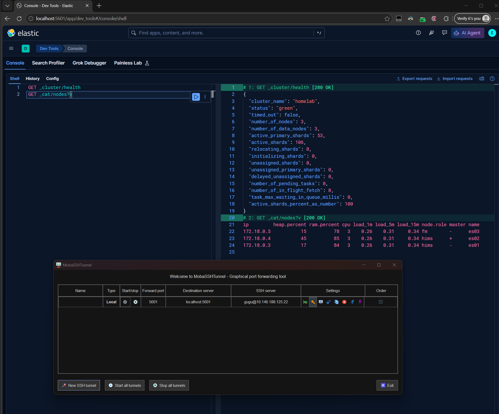

### 1.3 Antworten zu Teil 1

#### Warum drei master-fähige Nodes und nicht zwei?

Weniger als 2 master-fähige Nodes machen keinen Sinn in einem Cluster, da ein Master immer in der Mehrzahl gewählt werden muss. Bei zwei oder weniger Nodes führt der ungeplante Unterbruch einer Node zum Stopp des ganzen Clusters. Bei drei Nodes haben wir eine Mehrheit, was uns erlaubt, jeweils einen Ausfall zu tolerieren, ohne dass der ganze Cluster stoppt. Diese «Mehrheitslogik» ist in vielen Clusterlösungen verbreitet (Pacemaker/Corosync, Kubernetes etc.).

#### Welche Host-Einstellungen braucht Elasticsearch, damit es im Container startet?

Elasticsearch lauscht im Container auf der Docker-Netz-Adresse, weil die Nodes untereinander kommunizieren müssen. Dadurch erzwingt es beim Start die Bootstrap-Checks: [Bootstrap checks | Elastic Docs](https://www.elastic.co/docs/deploy-manage/deploy/self-managed/bootstrap-checks)

Generell sollte alles auf dem angegebenen Link berücksichtigt werden. In der Liste unten sind Änderungen und wichtige Überprüfungen zu finden, die ich gemacht habe.

| Was | Einstellung/Wert | Warum |
|---|---|---|
| Swap | Ausgeschaltet | Wird Speicher von Elasticsearch auf die Disk ausgelagert, wird der Node extrem langsam und kann aus dem Cluster fallen. Elastic empfiehlt deshalb, Swap abzuschalten. |
| `vm.max_map_count` | Default von Ubuntu in:<br>`/usr/lib/sysctl.d/55-map-count.conf: vm.max_map_count=1048576`<br>`/usr/lib/sysctl.d/50-default.conf: vm.max_map_count = 1048576` | Hier wurde nichts geändert, da der Standard vom OS bereits genug hoch ist. |
| File descriptor limit | In `docker-compose.yml`:<br>`ulimits:`<br>`  nofile:`<br>`    soft: 65535`<br>`    hard: 65535` | Elasticsearch braucht viele File Descriptors und File Handles. Falls dieses Limit erreicht wird, führt es im schlimmsten Fall zu Datenverlust. Zudem setzt Docker standardmässig den Wert auf 1024. |
| Maximum number of threads | SOLL: Min. 4096<br>IST:<br>`systemctl show containerd docker -p LimitNPROC` → `LimitNPROC=infinity` | Nichts direkt geändert, war schon alles genug hoch. Grund dafür ist die «hohe» Anzahl an Threads, die ein Elastic Stack braucht, und die Möglichkeit, neue Threads zu öffnen, ist wichtig. |
| System clock sync | Chrony | Keine Änderung nötig, da Ubuntu 26.04 standardmässig Chrony installiert hat. |
| Dateirechte | Gemountete Verzeichnisse für GID 0 schreibbar | Elasticsearch läuft im Container als UID 1000 / GID 0. Ohne Schreibrechte auf Daten- und Snapshot-Verzeichnis startet der Node nicht bzw. kann keine Snapshots schreiben. |

#### Welche Rolle spielt der Shared Cache auf dem Frozen Node, und wie hast du ihn dimensioniert?

Er ist die Voraussetzung, dass der «Frozen Tier» überhaupt funktioniert. Auf dem «Frozen Tier» liegen Indizes als «partially mounted searchable snapshots». Die vollständigen Daten befinden sich nur im Snapshot-Repository. Der Shared Cache als lokaler, reservierter Speicherbereich auf der Disk des Frozen Nodes wird dann von allen dort liegenden Shards geteilt.

**Dimensionierung:** Eigenes LV mit 30 GB → Shared Cache 27 GB

Der Default liegt bei 90 % der Disk und einem maximalen Headroom von 100 GB. Anfangs hatte ich das Volume von es03 (Frozen Node) auf dem gleichen LV wie die beiden anderen Nodes. Das führte dazu, dass ich den Standardwert anpassen musste aufgrund von: geteiltem Dateisystem, Disk-Watermarks, Cache wäre grösser als Repository.

Schlussendlich habe ich mich dafür entschieden, das Volume von es03 auf ein eigenes LV zu schieben, da ich noch ca. 174 GB Platz hatte auf der gesamten Disk. Dies erlaubt mir, Prod näher zu kommen und den Standardwert zu behalten.

---

## 2 Snapshots und Lifecycle bis Frozen

### 2.1 Snapshot-Repository

> Registriere ein Snapshot-Repository (MinIO/S3 oder Shared Filesystem) und verifiziere es.

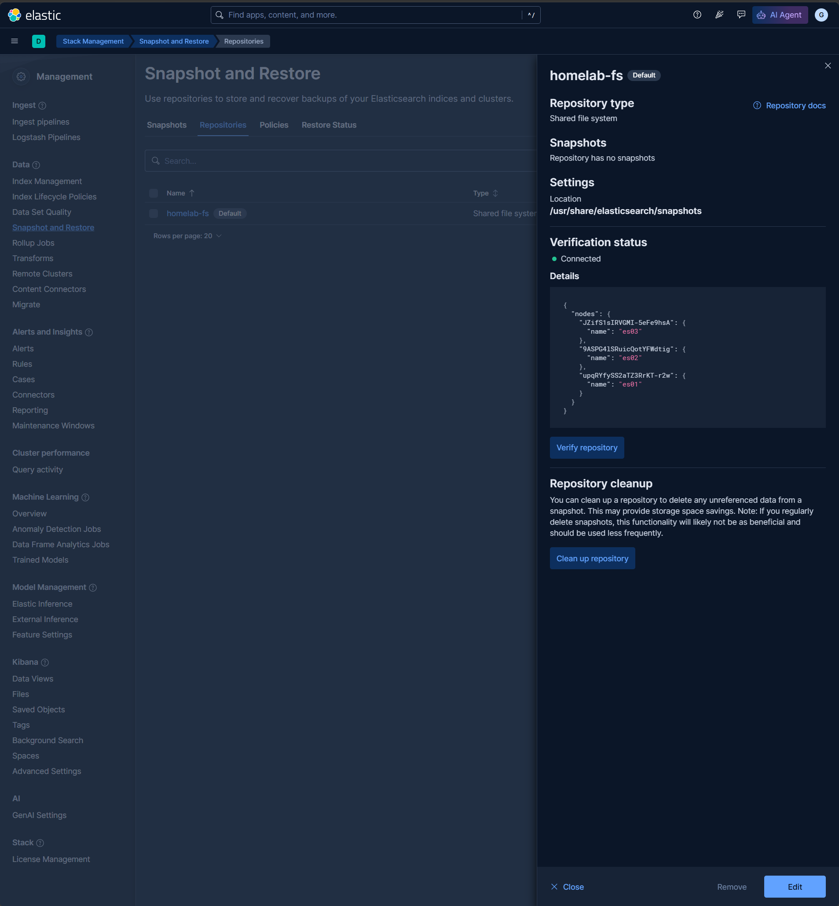

### 2.2 Daily SLM-Policy und Retention

> Lege eine SLM-Policy an, die täglich einen Snapshot erstellt und ältere Snapshots nach einer sinnvollen Retention löscht.

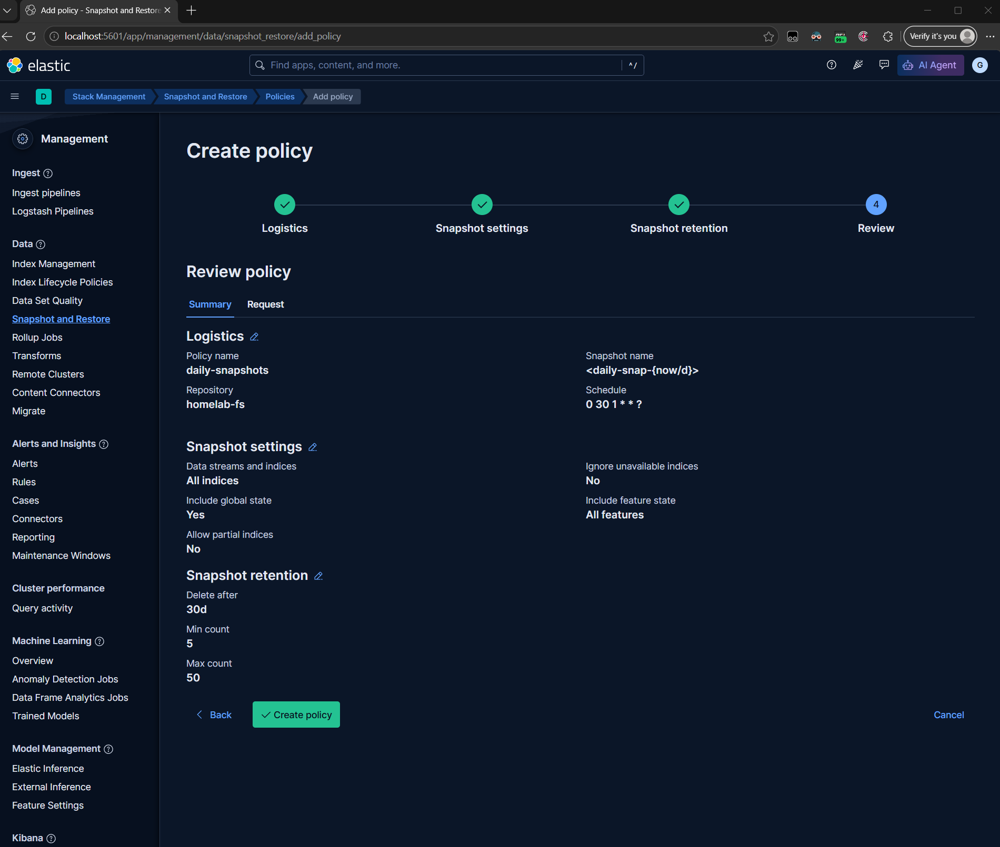

Standardwert der offiziellen Dokumentation.

**Min count:** Führt dazu, dass nicht alle Snapshots gelöscht werden können.

**Max count:** Mindestens so hoch wie Delete after. Empfehlenswert noch höher, dass z. B. für Testzwecke manuelle Ausführungen möglich sind.

### 2.3 ILM-Policy | Hot → Frozen

> Erstelle eine ILM-Policy, die Daten von Hot nach Frozen verschiebt. Für die Demo dürfen die Zeiten kurz sein (z. B. Rollover nach 10 Minuten, Frozen nach 15 Minuten).

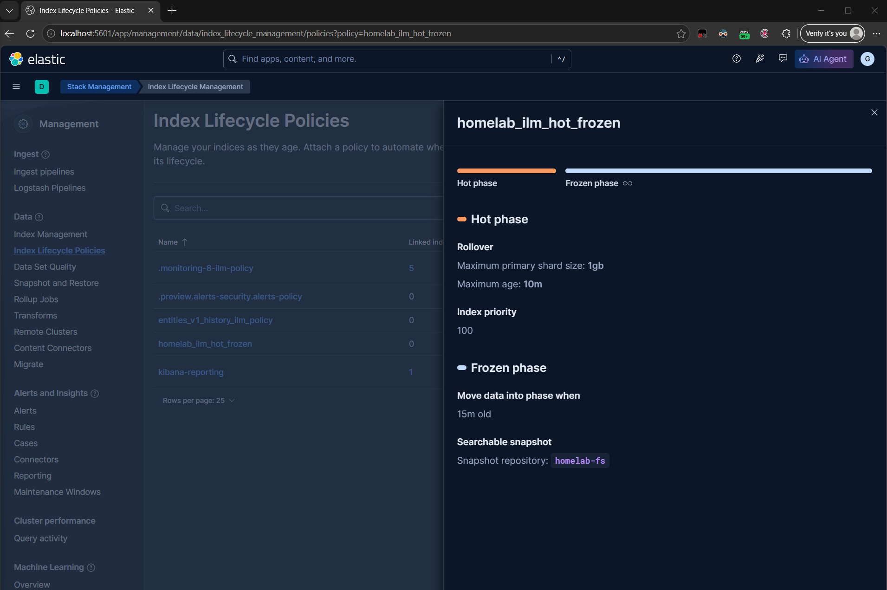

### 2.4 Index als Searchable Snapshot auf dem Frozen Node

> Zeige, dass ein Index tatsächlich als Searchable Snapshot auf dem Frozen Node liegt und weiterhin durchsuchbar ist.

Data Stream angelegt, da noch kein Fleet Server:

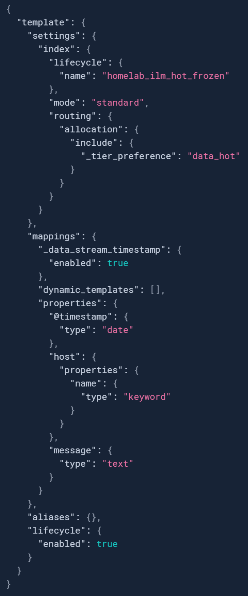

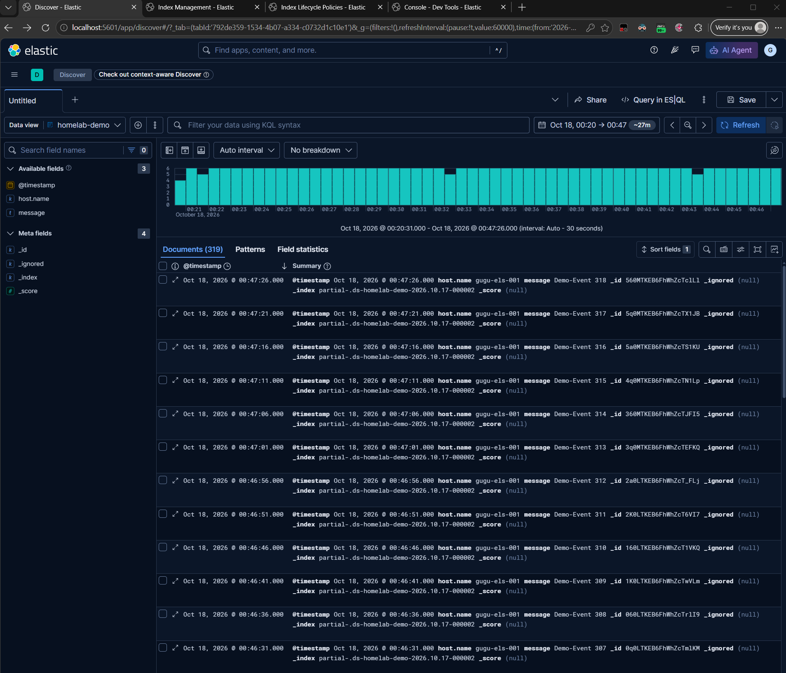

### 2.5 Restore-Test

> Lösche einen Index und stelle ihn aus einem Snapshot wieder her. Halte die Befehle fest.

**Testdaten anlegen**

```
PUT restore-index/_doc/1?refresh
{ "@timestamp": "2026-10-18T07:30:00Z", "message": "vor dem Backup 1" }

PUT restore-index/_doc/2?refresh
{ "@timestamp": "2026-10-18T07:30:00Z", "message": "vor dem Backup 2" }
```

**SLM-Policy auslösen**

```
POST _slm/policy/daily-snapshots/_execute
```

**Datenverlust simulieren**

```
DELETE restore-index
```

**Restore**

```
POST _snapshot/homelab-fs/daily-snap-2026.10.18-rcnps2cjtqq4baynkafota/_restore?wait_for_completion=true
{
  "indices": "restore-index",
  "include_global_state": false
}
```

---

## 3 Fleet Server und Elastic Agent

### 3.1 Fleet Server Container

> Betreibe einen Fleet Server (als Container im Compose-Setup).

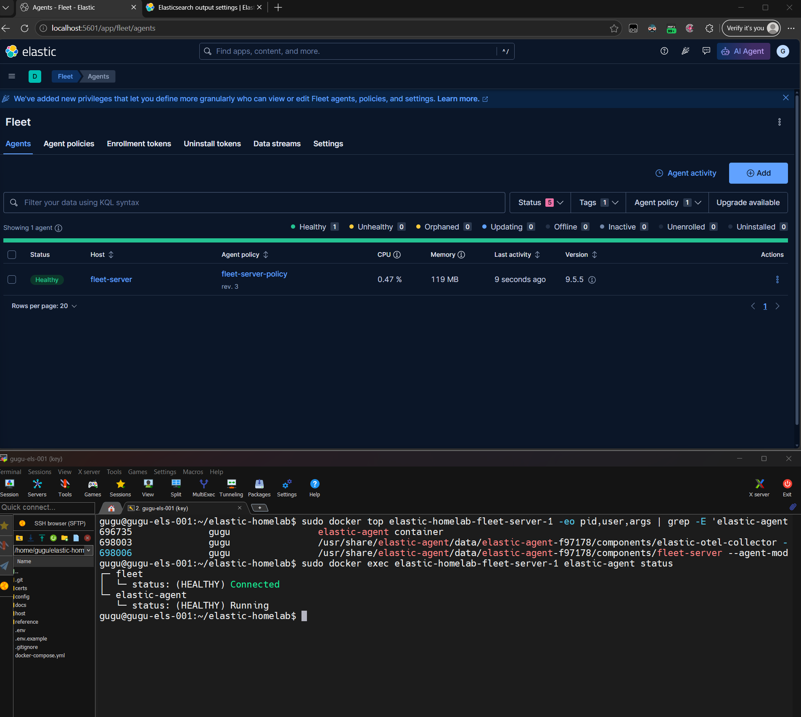

### 3.2 Elastic Agent Container

> Enrolle mindestens einen Elastic Agent – als Container oder direkt auf einem Host bzw. einer VM.

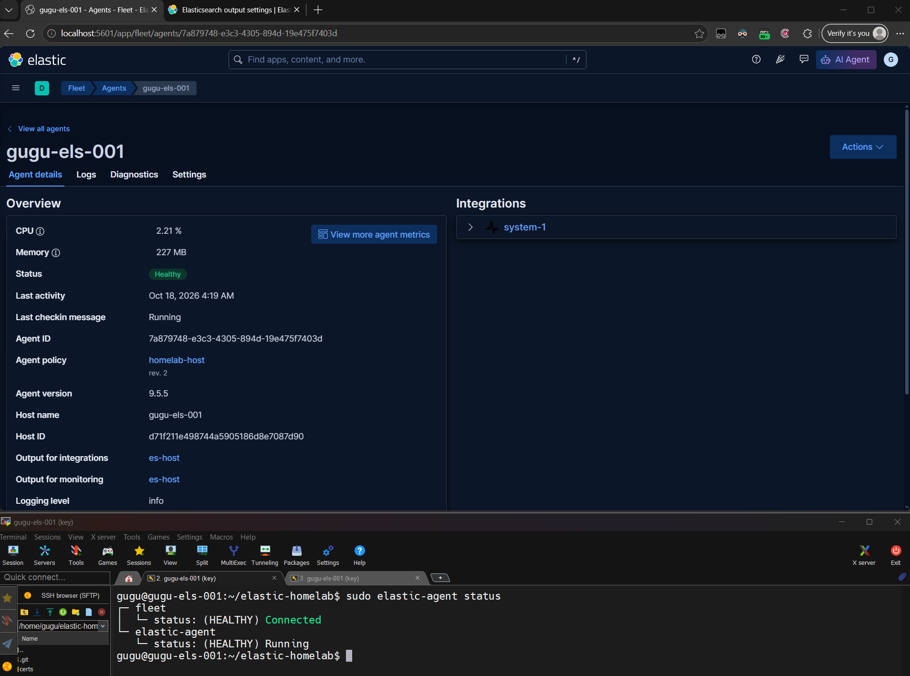

Agent nativ auf dem Server laufen lassen, für direkte Host-System-Metriken und -Logs.

### 3.3 Agent System-Metriken und -Logs (System-Integration)

> Der Agent liefert mindestens System-Metriken und -Logs (System-Integration) an den Cluster.

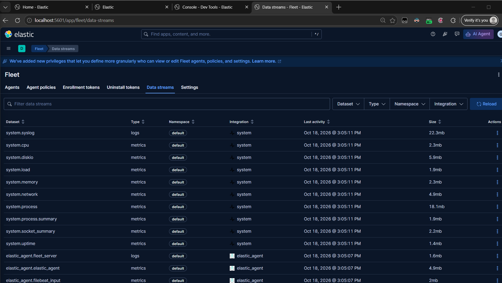

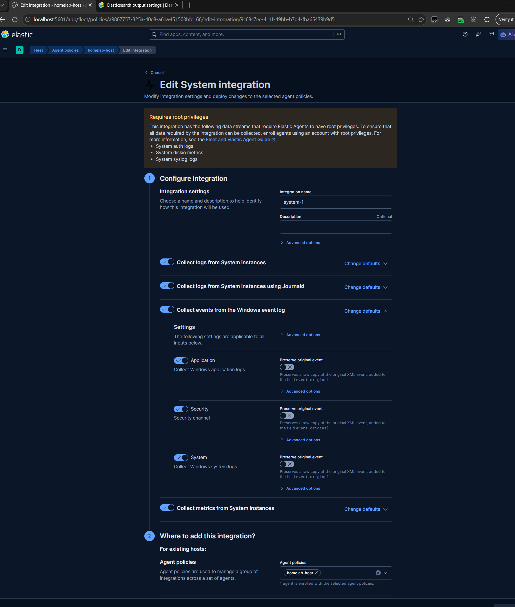

### 3.4 Daten in Kibana

> Zeige die eingehenden Daten in Kibana (Discover oder ein mitgeliefertes Dashboard).

![Dashboard [Logs System] Syslog](docs/images/teil3-syslog-dashboard.png)

### 3.5 TLS-Vertrauenskette zwischen Agent, Fleet Server und Elasticsearch

> Beantworte kurz: Wie funktioniert die TLS-Vertrauenskette zwischen Agent, Fleet Server und Elasticsearch in deinem Setup?

Alle Verbindungen beruhen auf einer eigenen CA. Jedes Zertifikat enthält als Subject Alternative Name den Dienstnamen sowie `localhost` und `127.0.0.1`. Jede Gegenstelle vertraut nur dieser CA, die explizit konfiguriert ist, und prüft den Hostnamen. TLS sorgt dabei für Verschlüsselung und Server-Authentisierung. Die Clients weisen sich nicht per Zertifikat aus, sondern mit Tokens bzw. API-Keys.

| Verbindung | Server zeigt | Client prüft mit |
|---|---|---|
| Agent → Fleet Server (`localhost:8220`) | `fleet-server.crt` (`FLEET_SERVER_CERT`) | `--certificate-authorities=/etc/ssl/elastic-homelab/ca.crt` |
| Fleet Server → Elasticsearch (`es01:9200`) | `es01.crt` | `FLEET_SERVER_ELASTICSEARCH_CA=/certs/ca/ca.crt` |
| Agent → Elasticsearch (Daten, Output) | `es01.crt` | `ssl.certificate_authorities` im Output: `es-host` → `/etc/ssl/.../ca.crt`, `es-internal` → `/certs/ca/ca.crt` |
| ES-Node ↔ ES-Node (Transport, 9300) | Node-Zertifikat | dieselbe CA, gegenseitig (mTLS) |

---

## 4 Fleet Policy ausrollen

### 4.1 Zweite Agent Policy

> Erstelle eine zweite Agent Policy (z. B. «homelab-docker») mit einer zusätzlichen Integration, etwa Docker oder Custom Logs für eine eigene Logdatei.

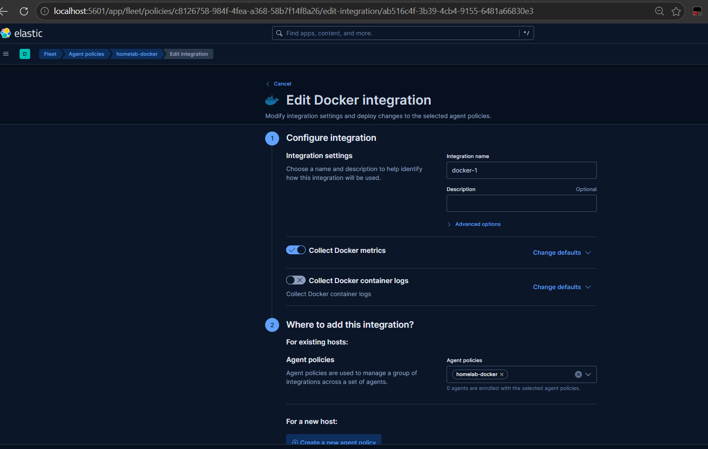

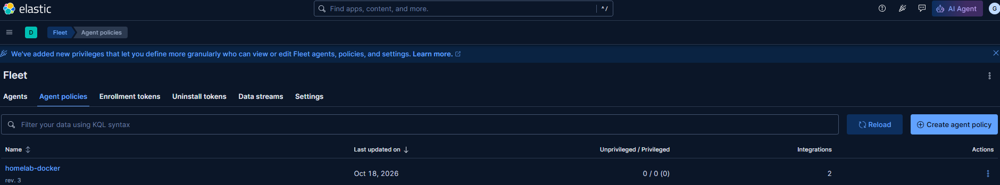

### 4.2 Neue Policy zuweisen

> Weise den Agent dieser Policy zu und zeige, dass die neue Konfiguration ankommt und Daten liefert.


### 4.3 Policy-Revision

> Ändere danach eine Einstellung in der Policy (z. B. Sammelintervall) und zeige, wie die neue Policy-Revision beim Agent ankommt.

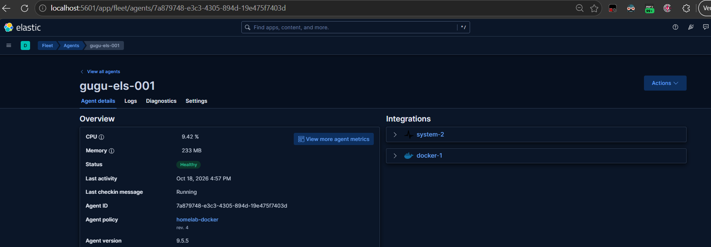

### 4.4 Policy als Code

> *Bonus: Definiere die Policy als Code statt nur über das UI – etwa über die Fleet API, die Kibana-Konfiguration (`xpack.fleet.agentPolicies`) oder Terraform.*

Vorlage aus [Create an agent policy without using the UI | Elastic Docs](https://www.elastic.co/docs/reference/fleet/create-policy-no-ui#use-preconfiguration-to-create-policy)

### 4.5 Policy-Änderung auf 500 Agents

> *Beantworte kurz: Wie würdest du eine Policy-Änderung auf 500 Agents ausrollen, ohne alle gleichzeitig zu treffen?*

Man könnte dies mit mehreren Policies kontrollieren, z. B.:

| Policy | Agents | Rolle |
|---|---|---|
| Linux-base-wave1 | 20 | Test environment oder unkritische Systeme |
| Linux-base-wave2 | 100 | Dev environment oder Testgruppe |
| Linux-base-wave3 | 380 | Prod environment oder Restsysteme inkl. kritische |

Somit könnte man die Agents gestaffelt auf die 500 Hosts ausrollen. Wichtig zu beachten ist, dass man hier auch jeweils eine eigene Integration für jede Policy anlegt, da sonst bei Änderung an der Integration wieder alle Hosts gleichzeitig getroffen werden.

Ein anderer Weg wäre, jeweils eine Kopie der Agent Policy zu erstellen, Änderungen darin vorzunehmen und dann die Systeme gestaffelt an die neue Agent Policy anzuhängen.

---

## 5 Konfiguration verstehen und abfragen

### 5.1 Setup-Einstellungen

> *Beschreibe, über welche Wege du in deinem Setup Einstellungen übergibst: Umgebungsvariablen im Compose-File, gemountete `elasticsearch.yml`, JVM-Optionen, Keystore, Cluster-Settings per API.*

| Weg | Im Setup |
|---|---|
| Umgebungsvariablen im Compose-File | Unter `environment:` pro Service. Jeweils mit vim das File editiert. Die Secrets kommen vom `.env`-File. |
| Gemountete `elasticsearch.yml` | Datei vom Image wird gebraucht, keine eigene Datei und kein Mount. |
| JVM-Optionen | Eigene Datei im Repo: `config/jvm/*.options`<br>Read-only als Bind-Mount nach `config/jvm.options.d/` im Container |
| Keystore | Nicht von Hand gefüllt. Das Image legt beim Start automatisch aus `.env` Einträge an. |
| Cluster-Settings per API | Vereinzelt GET gebraucht, selten effektiv konfiguriert mit PUT oder ausgeführt mit POST |
| Generelles Stack Management und Fleet Management | Vieles wurde direkt im GUI gemacht, einfacheres Verständnis visuell und tiefere Lernkurve |

### 5.2 Aktive Einstellungen und Defaults

> Ermittle für einen Node die effektiv aktiven Einstellungen, inklusive Defaults. Liefere die verwendeten Befehle bzw. API-Calls mit.

```
GET _nodes/es03/settings?flat_settings=true
```
→ Konfiguration auf dem Node selber

```
GET _cluster/settings?include_defaults=true&flat_settings=true
```
→ Alles andere inklusive Defaults

### 5.3 Quelle Einstellungen

> Zeige an einem Beispiel, welche Quelle gewinnt, wenn dieselbe Einstellung an zwei Orten gesetzt ist (z. B. `elasticsearch.yml` vs. Cluster-Settings-API).

| Quelle | Wert |
|---|---|
| `elasticsearch.yml` im Image | `docker-cluster` |
| Env-Variable im Compose-File | `homelab` |

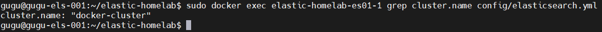

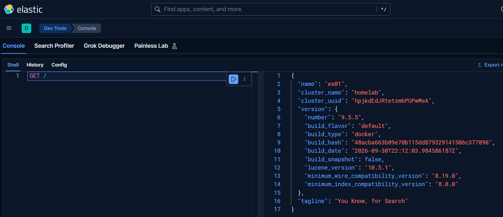

### 5.4 JVM-Heap-Grösse Nodes

> Ermittle, welche JVM-Heap-Grösse jeder Node tatsächlich hat und welche Node-Rollen aktiv sind – ohne in die Compose-Datei zu schauen.

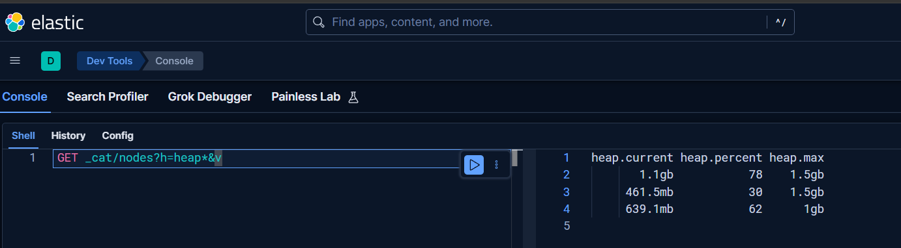

### 5.5 Schreibweise für Einstellungen Kibana und Fleet Server

> Kibana und Fleet Server nutzen im Container eine andere Schreibweise für Einstellungen als Elasticsearch. Erkläre den Unterschied an je einem Beispiel.

| Dienst | Beispiel |
|---|---|
| Elasticsearch | `http.host=0.0.0.0` |
| Kibana | `SERVER_HOST=0.0.0.0` |
| Fleet Server | `FLEET_SERVER_HOST=0.0.0.0` |

Alle Einstellungen stehen im selben Compose-File. Das Format bestimmt aber das Startskript des jeweiligen Images.
